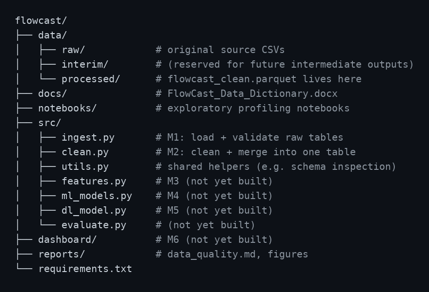

# FlowCast — AI-Driven Traffic Analytics Platform

An AI-driven traffic analytics platform that predicts traffic volume,
congestion, travel time, and accident risk using sensor, weather, and
calendar data — helping city traffic authorities make proactive traffic
management decisions.

Built on the Northline Corridor dataset: 25 road segments, 30-minute
sensor windows, January–May 2025 (~178K raw traffic readings).

---

## Pipeline Status

| Module | Description | Status |
|---|---|---|
| M1 | Ingestion & Validation | ✅ Complete |
| M2 | Cleaning & Merging | ✅ Complete |
| M3 | Feature Engineering | ⏳ Not started |
| M4 | Classical ML Models | ⏳ Not started |
| M5 | Deep Learning (LSTM) | ⏳ Not started |
| M6 | Dashboard | ⏳ Not started |

---

## Getting Started

### Prerequisites
- Python 3.10+
- pip

### Setup
```bash
git clone <your-repo-url>
cd Flowcast-Ai_Driven_Traffic_Analytic_Platform-/flowcast
python3 -m venv .venv
source .venv/bin/activate
pip install -r requirements.txt
```

### Running the pipeline so far
```bash
# Stage 1: load and validate the 3 raw source tables
python src/ingest.py

# Stage 2: clean, merge, and save the analysis-ready dataset
python src/clean.py
```
Running `clean.py` produces `data/processed/flowcast_clean.parquet` —
the single merged, cleaned table (176,701 rows, 33 columns) that all
later stages (feature engineering, modeling, dashboard) will consume.

### Data
Raw source files (not all committed for size reasons — check
`data/raw/` and `docs/FlowCast_Data_Dictionary.docx` for full column
definitions):
- `traffic_sensor_log.csv` — 25 road segments × 30-min windows, ~178K rows
- `weather_observations.csv` — 3 stations × hourly readings
- `calendar_events.csv` — 1 row per date, holiday/event/roadwork flags

---

## Project Structure




---

## M1 — Data Ingestion & Validation

**Code:** `src/ingest.py` implements three loader functions —
`load_calendar()`, `load_weather()`, `load_traffic()` — each performing
schema validation, type/date parsing, and flagging (not fixing) every
documented data-quality defect: duplicates, missing values, impossible
values, and label inconsistency. Fixing is deliberately deferred to
`src/clean.py` (M2), so validation and remediation remain independently
auditable.

**Verification:** Running `python src/ingest.py` standalone reproduces
the exact defect counts found manually during EDA (see
`notebooks/01_raw_data_profiling.ipynb`) — this agreement between
independent exploration and the automated pipeline is the evidence that
the validation logic is correct, not merely that it executes without
error.

**Findings:**
- 1,767 key-level duplicate rows (road_id + date + time) — sensor retries
- 4,387 / 4,382 / 4,383 missing traffic_volume / avg_speed / occupancy (~2.5% each)
- 241 negative traffic_volume, 237 avg_speed > 200km/h, 234 occupancy > 100%
- 26,883 (15.1%) blank congestion_level — by design, derived later from volume/capacity ratio
- weather_condition: 13 raw label variants collapsing to 4 real categories
- 167 missing temperature, 111 missing visibility readings
- Cross-file key consistency confirmed: 100% overlap between traffic's
  weather_station_id and weather's station_id (no orphaned keys)

---

## M2 — Data Cleaning & Merging

`src/clean.py` takes the three validated raw tables from M1 and fixes
every documented defect, producing one clean, merged, analysis-ready
table. The 9 steps run in a strict order, since each one assumes the
previous is already done — e.g. duplicates must be removed before
computing statistics, impossible values must be nulled before outlier
detection, and both tables' dates must be parsed before merging.

### 1. Deduplication
Sensor retries created duplicate rows sharing the same
`road_id + date + time`. Removed via `drop_duplicates(keep='first')` —
retries were treated as the same physical event logged twice, not
independent readings, so averaging wasn't used.
**Result:** 178,468 → 176,701 rows (1,767 removed).

### 2. Fixing Impossible Values
Negative `traffic_volume`, `avg_speed` > 200 km/h, and `occupancy` >
100% are physically impossible, not just statistically unusual. These
were set to `NaN` (not dropped as whole rows) so the rest of each row
stays usable, and so imputation (step 4) can treat them the same as
genuine missing data.
**Result:** 239 / 236 / 229 values nulled (traffic_volume / avg_speed / occupancy).

### 3. Statistical Outlier Handling
Outliers were detected using IQR bounds computed *within* each
congestion_level group rather than globally. An initial global-IQR pass
flagged 4,705 avg_speed outliers, 85% of which fell under Severe
congestion — meaning the naive approach was mostly flagging real
slow-traffic conditions as "wrong," not detecting sensor errors.
Grouped IQR (per congestion_level) reduced this to 527, concentrated in
Free-flow conditions, where an unusually slow reading is genuinely
suspicious.

**Decision:** outliers are flagged (`*_is_outlier` boolean columns) but
not nulled or imputed. This is a conservative choice — no real sensor
readings are altered or fabricated — and the flags remain available as
potential model features (an "anomalous reading" signal may itself be
predictive).

### 4. Imputation
Missing values (~2.5% each for traffic_volume, avg_speed, occupancy —
combining original sensor dropout and nulled impossible values) were
filled using grouped median imputation: median value for the same
road_id + hour + day_of_week combination, falling back to a global
median for any group with no valid values. This preserves realistic
time-of-day and road-specific traffic patterns instead of flattening
gaps to a single corridor-wide average.

### 5. Weather Label Harmonization
`weather_condition` had 13 raw variants (case differences, trailing
whitespace, alternate spellings like 'rainy'/'foggy') representing only
4 real categories. Normalized via lowercase + strip, then mapped to the
data dictionary's controlled vocabulary (Clear/Cloudy/Rain/Fog).
Overcast was folded into Cloudy, since it isn't one of the 4 documented
target categories.
**Result:** Clear 8,168 (75%) · Cloudy 2,202 (20%) · Rain 426 (4%) ·
Fog 76 (0.7%) — total matches raw row count exactly, confirming no
data loss.

### 6. Vehicle Type Distribution Parsing
`vehicle_type_dist` (a JSON string per row, e.g.
`{"2W":0.37,"Car":0.43,...}`) was parsed into 4 separate numeric
columns: `pct_2w`, `pct_car`, `pct_lcv`, `pct_hcv`.
**Result:** all 176,701 rows parsed successfully with zero failures.
Row-wise sums range 0.99–1.01 (mean 0.9999, median 1.0), confirming
valid distributions with only expected floating-point rounding.

### 7. Timestamp Alignment
Traffic (30-min grain) and weather (hourly grain) timestamps were
reconciled by flooring each traffic window's timestamp to its
containing hour (`weather_join_hour`). Both the `:00` and `:30` windows
within an hour correctly map to the same hourly weather reading, per
the data dictionary's specification. (Note: `weather_station_id` vs.
`station_id`, and the DD/MM/YYYY vs. YYYY-MM-DD date format difference,
were already resolved at the **ingestion** stage in `ingest.py` — each
loader parses dates into real `datetime` objects with an explicit
`format=` argument, so no format ambiguity remains by the time
cleaning/merging happens.)

### 8. Merging
Weather (joined on station_id + aligned hour) and calendar (joined on
date) were left-merged onto the traffic table, which remains the base
grain throughout.
**Result:** 176,701 rows before and after merge (no row loss or
duplication), with 0 unmatched weather keys and 0 unmatched calendar
keys — confirming full key alignment across all three source tables.

### 9. Deriving Congestion Level
The ~15% blank congestion_level values were filled using the
volume/capacity ratio formula from the data dictionary
(`V/C = traffic_volume / (road_capacity/2)`, banded into
Free-flow/Moderate/Heavy/Severe). Existing real labels were never
overwritten — only null values were filled.
**Result:** filled 26,624 values, leaving 0 missing.

**Final class distribution:** Free-flow 108,544 (61%) · Moderate 42,103
(24%) · Heavy 16,308 (9%) · Severe 9,746 (5.5%) — a meaningful class
imbalance to account for during classification modeling (M4).

### Schema Cleanup & Saving
After merging, two genuinely redundant columns were dropped in a final
`finalize_columns()` step:
- `station_id` — exact duplicate of `weather_station_id` after the merge
- `vehicle_type_dist` — raw JSON string, superseded by the parsed
  `pct_2w` / `pct_car` / `pct_lcv` / `pct_hcv` columns

All other derived columns (`hour`, `day_of_week`, `timestamp`,
`weather_join_hour`, `*_is_outlier` flags) were kept — not part of the
original raw schema, but useful inputs for feature engineering (M3).

The final table (176,701 rows, 33 columns) is saved to
`data/processed/flowcast_clean.parquet`. Parquet was chosen over CSV to
preserve exact dtypes (datetime, bool, float) and for faster reload in
later pipeline stages.

---

## Roadmap
- **M3 — Feature Engineering:** 

### Cyclical Time Encodings
`hour` and `day_of_week` were encoded as sine/cosine pairs rather than
raw integers, so models correctly treat time as circular (23:00 is
close to 00:00, Sunday is close to Monday) instead of as a flat scale
where those boundaries would appear maximally far apart. Also added
`is_rush_hour` (weekday mornings 7-9am / evenings 5-7pm).
Verified: hour=23 and hour=0 produce near-identical (sin, cos) pairs,
confirming correct wraparound. is_rush_hour flags 21,080 rows (11.9%),
consistent with the expected proportion of weekday rush-hour windows.

### Lag Features
Added traffic_volume_lag_1/2/4/48 (30min/1h/2h/24h ago), computed per
road_id after sorting by road_id + timestamp, using groupby().shift()
to guarantee no value crosses between different roads' time series.
Verified by inspecting one road's sequence directly: each lag value
exactly matches the corresponding earlier reading for that same road;
the first N rows of each road's series correctly show NaN (no prior
data to look back to yet).


### Rolling Window Features
Added rolling mean/std of traffic_volume over 2h/4h windows (4/8
steps), computed per road_id. Critically, values are shift(1)'d before
rolling — this excludes each row's own value from its own window,
preventing the model from "seeing" the value it's meant to predict.
Verified by hand: row 02:00's rolling_mean_4 (96.50) exactly matches
the average of the 4 prior readings (119,91,94,82), correctly
excluding that row's own value (116).


- **M4 — Classical ML:** regression (traffic_volume), classification
  (congestion_level) across 5 model types, with time-series cross-validation
- **M5 — Deep Learning:** LSTM/GRU sequence models, benchmarked against
  classical ML
- **M6 — Dashboard:** Streamlit app for live predictions and visualization